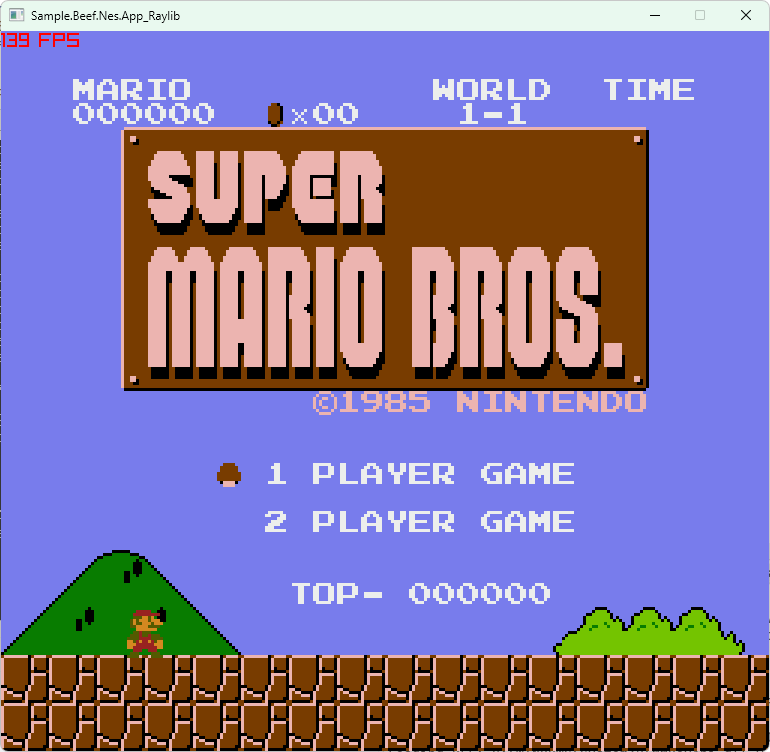

# Sample.Beef.Nes

Sample [NES(Nintendo Entertainment System)](https://en.wikipedia.org/wiki/Nintendo_Entertainment_System) Emulator Implemented in the Beef.

- [beeflang](https://www.beeflang.org/)
- libs
  - [SedulousWorks/SDL3-Beef](https://github.com/SedulousWorks/SDL3-Beef)
  - [Starpelly/raylib-beef](https://github.com/Starpelly/raylib-beef/)

## Implemented

- CPU
- PPU
- APU
  - no DMC
- Mapper
  - only NROM(mapper 0)

## Screenshot

## Ref

- Dotnet verison is here: [netpyoung/Sample.Dotnet.Nes](https://github.com/netpyoung/Sample.Dotnet.Nes)